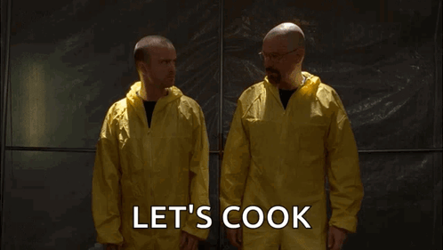

<!-- ===================== HEADER ===================== -->

# សួស្តី! I'm Ratanak ✨

**Sophomore · Computer Science Student · AUPP · Cambodia**

Connect with me !

 

*"Be Water My Friend"*

## 🙋 About Me

- 🎨 I love exploring new concepts and technologies that are evolving around my field.

## 🧰 Toolbox

<table>
  <tr>
    <td align="center" width="25%"><b>💻 Languages</b></td>
    <td>
      
      
      
      
    </td>
  </tr>
  <tr>
    <td align="center"><b>🎨 Front-end</b></td>
    <td>
      
      
      
      
      
      
      
    </td>
  </tr>
  <tr>
    <td align="center"><b>🗄️ Back-end</b></td>
    <td>
      
      
      
    </td>
  </tr>
  <tr>
    <td align="center"><b>💾 Databases</b></td>
    <td>
      
      
      
      
    </td>
  </tr>
  <tr>
    <td align="center"><b>☁️ Deploy</b></td>
    <td>
      
      
      
    </td>
  </tr>
  <tr>
    <td align="center"><b>🛠️ Tools</b></td>
    <td>
      
      
      
      
      
    </td>
  </tr>
</table>

---

## 🌟 Things I've Built

<table>
  <tr>
    <td width="50%" valign="top">
      
      <h3>[Emoji] [Project One Name]</h3>
      
[What it does and who it's for, in one or two lines.]

      
✨ <b>Highlights:</b> [Feature 1] · [Feature 2] · [Feature 3]

      
      
        
      <a href="https://[live-link]">🔗 Live demo</a> · <a href="https://github.com/[username]/[repo]">📂 Code</a>
    </td>
    <td width="50%" valign="top">
      
      <h3>[Emoji] [Project Two Name]</h3>
      
[What it does and who it's for, in one or two lines.]

      
✨ <b>Highlights:</b> [Feature 1] · [Feature 2] · [Feature 3]

      
      
        
      <a href="https://[live-link]">🔗 Live demo</a> · <a href="https://github.com/[username]/[repo]">📂 Code</a>
    </td>
  </tr>
  <tr>
    <td width="50%" valign="top">
      
      <h3>[Emoji] [Project Three Name]</h3>
      
[What it does and who it's for, in one or two lines.]

      
✨ <b>Highlights:</b> [Feature 1] · [Feature 2] · [Feature 3]

      
      
        
      <a href="https://[live-link]">🔗 Live demo</a> · <a href="https://github.com/[username]/[repo]">📂 Code</a>
    </td>
    <td width="50%" valign="top">
      
      <h3>[Emoji] [Project Four Name]</h3>
      
[What it does and who it's for, in one or two lines.]

      
✨ <b>Highlights:</b> [Feature 1] · [Feature 2] · [Feature 3]

      
      
        
      <a href="https://[live-link]">🔗 Live demo</a> · <a href="https://github.com/[username]/[repo]">📂 Code</a>
    </td>
  </tr>
</table>

## 🤝 Let's Work Together

I'm currently open to:

- 💼 **[Internships / Jobs]** — [type of role, e.g. front-end, full-stack]
- 🧑‍💻 **[Freelance]** — [e.g. landing pages, small business websites]
- 🌱 **[Collaborations]** — [e.g. open-source or student projects]

📬 The fastest way to reach me is **[Telegram / Email]**: [your contact]

---

<b>🎮 When I'm not coding... (click me)</b>

 

- 📺 **Watching:** classic American Movies
- 🍜 **Favourite food:** Anything with meat
- ☕ **Fuel:** Water for dear life

 

---

**Thanks for stopping by! [Your closing line, e.g. Let's build something cool together 🚀]**

Made with 💜 by Ratanak · Last updated November 2026 

